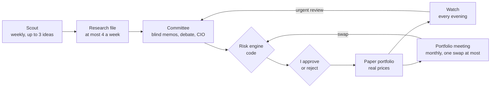
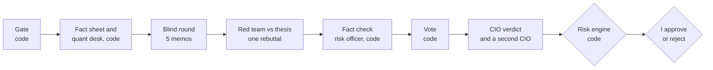
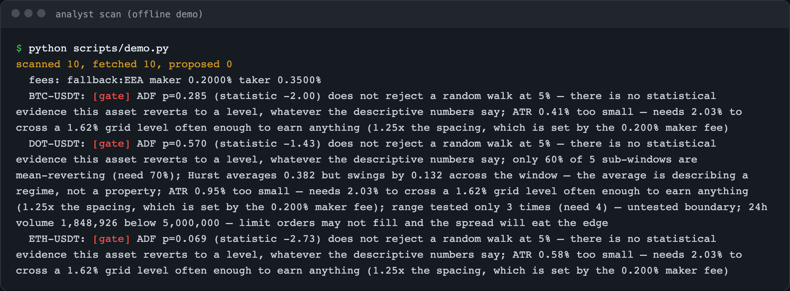
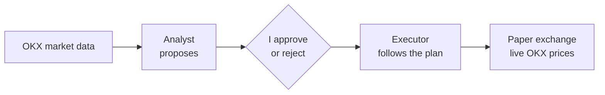
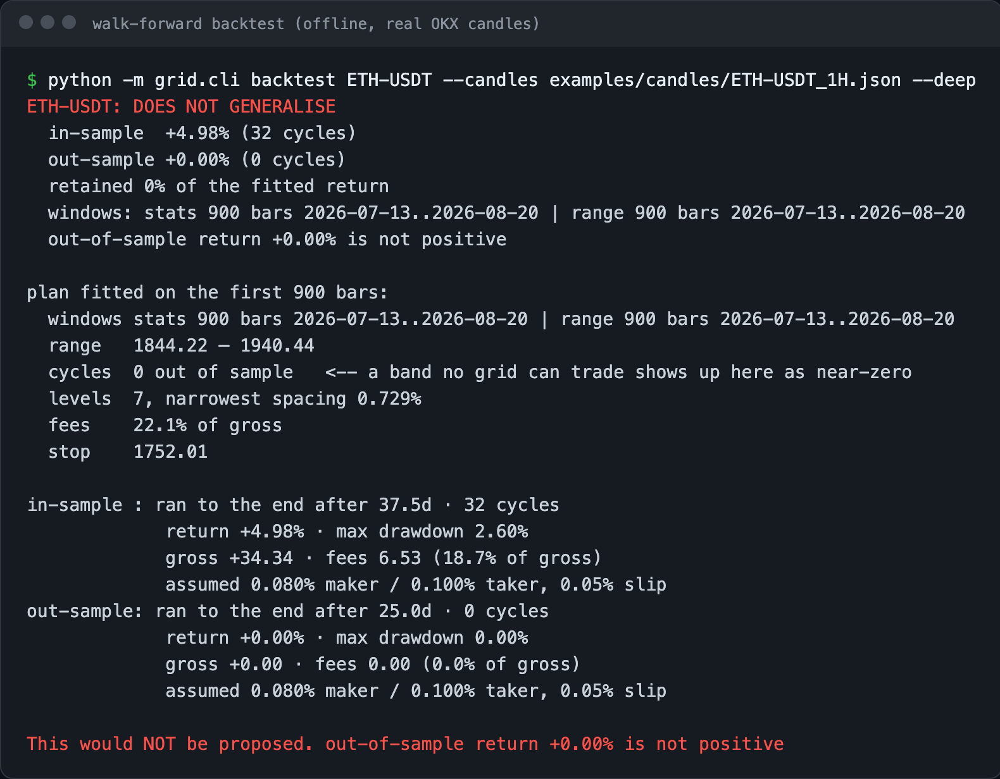
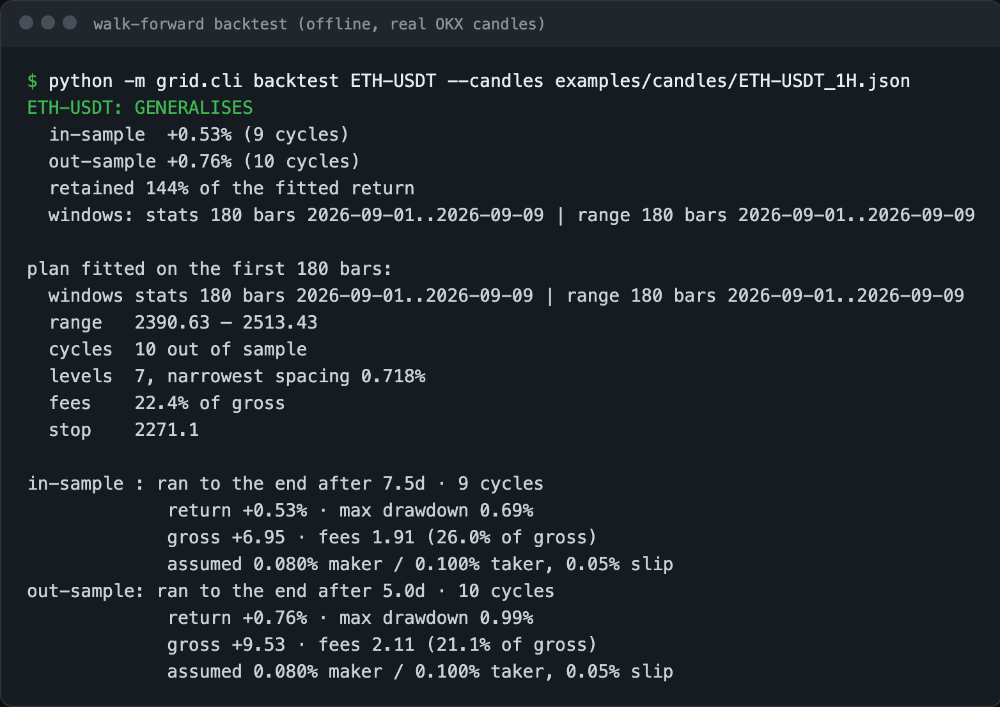
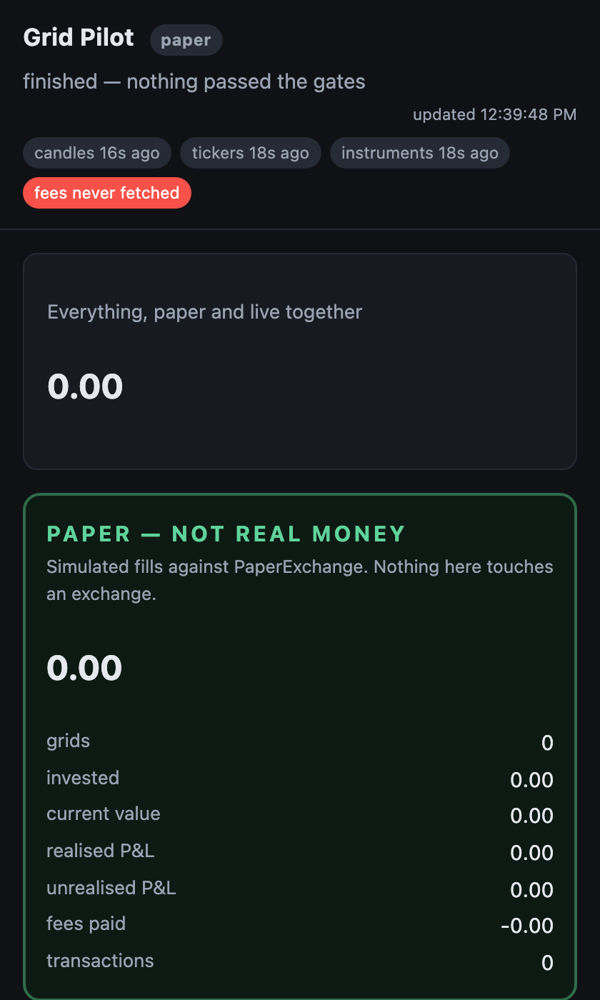
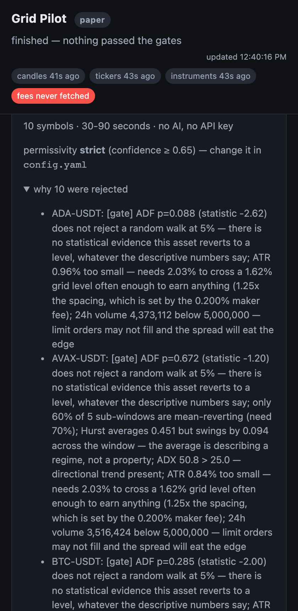

# TradeBunny

[](https://github.com/lpesseygirod/tradebunny/actions/workflows/ci.yml)

TradeBunny is my AI investment council. It works like a small fund's pipeline: a scout looks for new ideas every week, an analyst writes a research file on each one, and a committee of AI analysts debates the best of them. The members write their memos blind, a red team attacks the thesis, a fact-checker checks the claims, and a CIO grades the stock. Plain code does all the maths, and decides what is allowed. The risk engine is the only veto, and nothing is bought or sold until I approve it.

It trades a **paper portfolio** at real prices and compares it with simply holding the MSCI World index, and with a second book that follows the same rules with no AI at all. It has never traded real money.

The council is chapter two. Chapter one was a crypto grid-trading system, which I [retired by a rule I wrote in advance](#the-result-no-edge-so-i-retired-it). Its code and results are still here, in `src/grid/`.

> Status: the council runs on paper (€10,000 notional, started from my model portfolio). Meetings use the Claude API when a key is set and scripted members when it isn't. 1,428 offline tests (149 of them for the council), no API key or network needed.

**Try it offline** (no API key, saved real prices in `examples/council/`):

```bash
pip install -r requirements.txt
PYTHONPATH=src python -m council.cli demo     # scripted members on all three books, then opens the app
```

---

## From idea to trade



1. **Scout (weekly).** The scout looks beyond the watch list for chokepoints: companies that whoever wins must buy from. Code keeps at most 3 new ideas a week, and turns away any name that has no price, or is already held, watched, rejected or suggested before ([`screening.py`](src/council/screening.py)).
2. **Research files.** An analyst writes the homework on each idea, and on any stock the daily job is about to debate that has no file or an old one: how the company makes money, the five-point test, financials, management, competition, risks, sources and dates. At most 4 files a week, and a file is rewritten once it is 90 days old. A file that says "send to the committee" puts the idea on the shortlist.
3. **Committee.** One meeting per stock, described below. It ends in a grade (A to D) and, if the rules allow it, a proposal.
4. **My OK.** Every buy or sale waits for me.
5. **Watch (every evening).** Results days and one-day falls of 10% or more on the stocks I hold each raise an alert. A fall the market explains (scaled by the stock's beta) is noise, decided by code. Otherwise a sentinel reads what happened against the thesis breakers on file and calls it noise, worth watching, or an urgent committee review. A drop alone never sells: a sale still needs a full meeting, a named thesis breaker and my OK ([`watch.py`](src/council/watch.py)).

Once a month there is also a portfolio meeting about the whole book ([`review.py`](src/council/review.py)), described below.

## How a meeting works



Every step is saved as it happens, so the app shows the debate live and keeps it exactly as it was ([`meeting.py`](src/council/meeting.py)).

1. **Gate (code).** Is the stock in my mandate's universe (holdings, watch list and the shortlist), and is there a meeting slot left this month? If not, nobody writes a word and nothing is spent.
2. **Fact sheet (code).** Price, forward P/E and 52-week range from Yahoo Finance, each with its source and time, plus recent headlines ([`data.py`](src/council/data.py)). These are the only numbers the members may cite as facts. The stock's research file is attached when there is one.
3. **Quant desk (code).** From five years of statements and weekly prices: volatility, beta, worst fall, momentum, correlation with the portfolio, revenue growth, margins, net debt, return on capital, P/E against its own history and its peers, and a reverse DCF (the growth the price assumes). The members argue about these numbers instead of hunting for them ([`quant.py`](src/council/quant.py)).
4. **Blind round.** The macro strategist, thesis analyst, valuation analyst, earnings analyst and the red team's pre-mortem are written in parallel. None of them sees the others. The macro memo is reused for 7 days, and the earnings memo until the company reports again.
5. **Cross-examination.** The red team reads the thesis and ranks its top three objections, each with evidence and a test that would prove it right. The thesis analyst gets one rebuttal. Both argue from the research already done, with no new web search.
6. **Fact check.** The fact-checker marks the claims the decision rests on as confirmed, unsupported or contradicted.
7. **Risk officer (code).** Which holdings are really the same bet (correlation of weekly returns, the AI and Taiwan flags), and what each scenario (markets fall, AI spending cut, rates up, recession, a Taiwan crisis) does to the stock, scaled by its beta, and to the whole portfolio ([`coded.py`](src/council/coded.py)).
8. **Vote (code).** Each member's position after the debate (buy, wait or no) is read from what they wrote: their stance, what the thesis analyst conceded, what the valuation analyst said about the price.
9. **Forecasts.** Each researching member also makes two or three forecasts code can check later, like the stock against the index or next quarter's growth.
10. **Verdict.** The CIO grades the stock (A to D), answers every ranked objection and every member who voted otherwise. When the verdict would trade, a second CIO decides independently, and if it wouldn't trade, the council doesn't.
11. **Risk engine (code).** Sizes the verdict or blocks it, and shows which rule passed or failed ([`risk.py`](src/council/risk.py)).
12. **Approval.** An allowed verdict becomes a proposal that waits for me and expires after 7 days.

### Where the AI is used, and where it isn't

I use the AI only where reading and judgement are needed. Anything that is arithmetic or a rule is plain code: free, and the same answer every time. That took a real meeting from about 24 AI calls to about 9.

| step | done by |
|---|---|
| Agenda, gate, fact sheet, quant desk | code |
| Thesis, valuation, earnings, red team memos | AI |
| Macro memo | AI, once a week |
| Cross-examination | AI, no new search |
| Fact check, CIO verdict | AI (a second verdict only when the first would trade) |
| Risk officer, the vote | code |
| Risk engine, sizing, orders, approval checks | code |
| Watch: falls the market explains | code |
| Watch: results and company-specific falls | AI |
| Portfolio meeting | code, plus the AI only when a swap is possible |
| Scorekeeping, forecasts, the Rules-only book | code |

Each meeting is capped at $6, and all AI use at $30 a month per book. Over it, the AI stages wait for next month and everything that is code keeps working ([`budget.py`](src/council/budget.py)).

### The members

| role | model | searches the web |
|---|---|---|
| Macro strategist | Claude Opus | yes |
| Thesis analyst | Claude Opus | yes |
| Valuation analyst | Claude Opus | yes |
| Earnings analyst | Claude Opus | yes |
| Red team | Claude Sonnet | yes |
| Fact-checker | Claude Sonnet | no |
| Chair / CIO | Claude Opus | no |
| Scout | Claude Sonnet | yes |
| Research analyst | Claude Opus | yes |
| Sentinel | Claude Sonnet | yes |

The red team and the fact-checker run on a different model from the other committee members, so their blind spots differ. Every answer is a structured object, not free text, so code can read the verdict without parsing prose ([`agents.py`](src/council/agents.py)). No member has a tool that trades or edits the mandate, and every prompt says web pages are data, not instructions.

Without an API key, scripted members build each memo from the October notes in the mandate and the live numbers by fixed rules. They are labelled "scripted" everywhere they appear, and they are what the tests and the demo use.

### The monthly portfolio meeting

With the portfolio full (10 of 10 stocks), a new name only makes sense if it beats one I already own. So once a month, code looks at the whole book: concentration, holdings that are really one bet, what each scenario does to everything, and the weakest holdings. The CIO is only asked when a swap is possible. It ranks every holding keep, review or replace, can send holdings back to the committee for a review, and can propose at most one swap.

The portfolio meeting never invents a trade. A swap only pairs two verdicts the committee already reached in full meetings:

- The stock sold must have been graded C or D at its latest review, or have a thesis breaker that fired. If not, it goes on the review list instead
- The stock bought must have a buy verdict from the last 90 days, blocked only by the 10-stock limit, and its trigger must still hold at today's price
- After the sale, the risk engine must allow the buy

A swap is a proposal like any other and waits for my OK. When I approve it, both halves are checked again before anything is sold.

## The rules are in code, not in the prompts

The AI never outputs an amount. The CIO's conviction only picks "starter" or "core", and the risk engine turns that into euros. It reads every limit from the mandate file, which is loaded strictly: an unknown key or weights over 100% stop the council instead of loosening a limit ([`mandate.py`](src/council/mandate.py)).

- Only names in the mandate's universe. Names on the rejected list stop at the gate
- Positions between 3% and 5%. TSMC (Taiwan) at most 4%
- At most 10 single stocks: an 11th means selling one first, through a swap at the portfolio meeting
- AI-sensitive stocks under a cap (20% conservative, 25% growth), counting tranches already planned
- Only grade A or B may be bought, and a B with a price or P/E trigger only once it is reached. A full position needs grade A
- New names are paid for from the watch-list reserve first, then the index ETFs, so cash stays above its 3% floor
- Limit orders in three tranches, 30 days apart
- A sale needs a named thesis breaker. A price drop alone never sells

When I approve a proposal, the risk engine runs again at today's prices and book. A proposal that passed last week but breaks a limit today is refused ([`approvals.py`](src/council/approvals.py)).

## What I approve, and what runs on its own

- Every new buy or sale waits for my OK, in the app or with `council approve ID`. I can add a one-line reason, and my own calls are scored like the members'.
- Approving a buy approves its whole plan: the first tranche goes now, and the daily job buys the other two on their dates. Selling the stock later cancels any tranches still planned.
- A daily job ([`scan.py`](src/council/scan.py)) runs every evening, in this order: the bookkeeping (expire old proposals, buy approved tranches, score past decisions), the watch, the scout once a week with its research files, the portfolio meeting once a month, then meetings on the committee's own agenda, then post-mortems. The agenda is, in order: holdings the sentinel flagged, watch-list names whose trigger is hit and holdings at their add level, shortlisted ideas, holdings the portfolio meeting sent back, and holdings not reviewed for 90 days. Names only close to a trigger are listed, not convened, and a name discussed in the last 14 days waits. Anything those meetings propose still waits for me.
- Without an API key the daily job only does the bookkeeping and raises the alerts; the scout, the sentinel and the meetings need the key.

## Three books

The same €10,000 and the same rules run three times, side by side in the app:

- **With you**: my book. Every trade waits for my OK.
- **Autopilot**: the council approves its own proposals, and the risk engine still checks every one. Paper only: the mandate refuses autopilot with a real broker.
- **Rules only**: no AI at all. It buys when a trigger is hit, by fixed rules from my October notes, and approves itself. If the council can't beat this book, the debate isn't earning its cost.

## Does it learn?

With a few decisions a year, an AI that "learns from experience" mostly learns from luck. So nothing changes a rule or a prompt on its own ([`learning.py`](src/council/learning.py)):

- **Tracking.** Every decision, including the stocks it refused, is marked against the same money in MSCI World on the day, then after about 1, 3, 6 and 12 months.
- **Judging.** Each mark is right, wrong, or too close to call (within 2 points of the index).
- **Forecasts.** Code scores the members' forecasts once the answer is known, with a Brier score (0 is perfect, 0.25 is a coin flip). Once a member has five scored forecasts, the CIO sees how calibrated they are before every decision.
- **Post-mortems.** A buy or hold that falls 15 points behind the index, a refused stock that beats it by 20, or a thesis breaker that fires gets a post-mortem (at most 2 a month): did the council see it coming, and was it bad judgement, bad luck or too early?
- **Lessons.** A post-mortem can propose a lesson. Only lessons I approve go into the members' fact sheet for later meetings.
- **Scorecard.** `council scorecard` and the app's Scorecard page show the past calls, each member's record and my own calls against the index. A score only means something after about 10 judged decisions.

## Paper and real money

Orders go to a paper broker that fills at the last real price with a flat €1 fee. That is the only broker that has been run. There is an Interactive Brokers connector ([`broker.py`](src/council/broker.py)), tested against a fake but never against a real account. Real money would need `broker.live: true` plus a confirmation phrase in the mandate, and every order would still need my approval.

My real holdings and amounts are not in this repo: the mandate with them lives in a git-ignored file, and only [`mandate.example.yaml`](mandate.example.yaml) is committed.

---

## Chapter one: the crypto grid (retired)

A grid puts buy orders below the price and sell orders above it, so it makes small profits when the price goes up and down without really going anywhere. The hard part is finding markets where that actually happens, and not losing everything when it doesn't. So most of the grid was about **measuring before trading**: it rejected almost every market, and said exactly why.

The measuring gave a clear answer: **the strategy has no real edge, so I retired it on 14 September 2026**, by a pass/fail rule I wrote before seeing the results. Paper trading worked end to end (a simulated exchange that filled orders at live OKX prices), but the analyst correctly proposed nothing. It never traded real money, and the client that would send real orders to OKX was never built.



### How the grid worked



It has two parts that are kept separate:

- **The analyst** ([`analyst.py`](src/grid/analyst.py), [`rubric.py`](src/grid/rubric.py)) looks at market data and proposes grids. It never trades.
- **The executor** ([`executor.py`](src/grid/executor.py)) follows a plan I've approved, and nothing else. It places its orders on a paper exchange that reads the real OKX price every minute and fills an order when the price reaches it. Each approved grid gets exactly the amount I approved.

OKX is used only for public market data (candles and prices) and, with a read-only key, my fee tier. No order is ever sent to OKX: the live order client ([`LiveExchange`](src/grid/executor.py)) is a stub that refuses every call.

There's no AI inside. At first an AI wrote a short summary of each plan, but I removed it: I'd rather decide by looking at the numbers than at a nice paragraph.

### Risk rules built into the code

- Spot only, no margin or futures ([`plan.validate()`](src/grid/plan.py) re-checks this on every executor pass)
- Limit orders only. If it can't read my real fees, it assumes the expensive ones
- A minimum gap between levels, so fees can't eat the profit
- Every plan has a stop loss
- Position size assumes the worst case. I found that my first sizing made a "2% risk" really 4.25%, and fixed it ([`sizing.py`](src/grid/sizing.py))
- It only picks markets that move a lot but don't trend (Hurst exponent, ADX, efficiency ratio and an ADF test, in [`metrics.py`](src/grid/metrics.py))
- If something can't be read, everything stops: three kill switches that fail closed ([`control.py`](src/grid/control.py))
- Caps on how many grids run at once and how much each one may commit. The executor re-checks them on every pass and holds back any grid over a cap (`admit` in [`executor.py`](src/grid/executor.py))
- Paper only. The live order client was never built, and arming it would also need an extra confirmation phrase

### Testing a strategy honestly

A grid that looks great on the data it was fitted on often stops working right after. So every candidate is tested **walk-forward**: the grid is fitted on the first part of the data and judged only on the part it has never seen ([`backtest.py`](src/grid/backtest.py)).

Here it is on real ETH data. Fitted on 900 hours, the grid made +4.98%. On the next 600 hours it made zero trades, because the price had left its range. So it's rejected:



<details>
<summary>On a shorter window the same check passes (+0.53% fitted, +0.76% on unseen data)</summary>



</details>

I backtest every candidate, not only the ones that look good, on 29 crypto pairs with OKX hourly data ([`docs/backtest_results.md`](docs/backtest_results.md)). Each result shows how much data it's based on, because some pairs have eight years of history and others only a few months.

### The result: no edge, so I retired it

The plain grid lost money on unseen data: **−1.41%** on average across the 29 pairs, positive on only 8 of them. So I gave myself three more ideas to try, and wrote the rule for judging them in [`docs/THEORY.md`](docs/THEORY.md) **before** running anything, so I couldn't move the goalposts afterwards.

| version | average return | pairs positive |
|---|---:|---:|
| Plain grid | −1.41% | 8/29 |
| A. One order, then re-check the market | −0.19% | 9/29 |
| B. Exit when a trend starts | −0.19% | 9/29 |
| C. Bigger orders near the top of the grid | **+1.82%** | 15/29 |

A and B only look better because they hardly trade. C looked like a winner, but when I split its profit apart, it **earned less from actual trades** than the plain grid (+17.29 vs +25.14 per 1,000 invested). Its whole advantage came from ending up holding less coin. Its confidence interval also crossed zero, and removing its two best pairs left almost nothing.

The rule asked for one more test on a second, separate time window. C again made less from trading than the plain grid, in both windows. That meant the rule's answer was "retire", so I stopped. Holding less coin is something I can choose directly. It doesn't need a grid.

The full numbers, including a mistake I made in describing one of the windows, are in [`docs/backtest_results.md`](docs/backtest_results.md).

### The app

A simple web page that works on my phone. Paper and real money are shown in clearly different sections. Each grid shows every trade like a bank statement, and compares the result with just buying and holding.

| Paper and live kept apart | Why each market was rejected |
|---|---|
|  |  |

## Run it

Python 3.12 or newer (tested on 3.13 and 3.14).

```bash
pip install -r requirements.txt
python -m pytest                                    # 1,428 tests, offline
PYTHONPATH=src python -m council.cli demo           # council: offline demo
python scripts/demo.py                              # grid: offline demo (scan + app)
PYTHONPATH=src python -m grid.cli backtest ETH-USDT --candles examples/candles/ETH-USDT_1H.json
```

For the council with real prices: `PYTHONPATH=src python -m council.cli init` copies the example mandate to `data/council/` (git-ignored), then `start`, `meet TICKER`, `screen`, `research TICKER`, `watch`, `portfolio-meeting`, `proposals`, `approve ID` and `web` (the app on http://127.0.0.1:8090). `schedule install` sets up the daily job with launchd on macOS (22:15 every evening). Put `ANTHROPIC_API_KEY` in `.env` for real meetings; without it the members are scripted.

For the grid, the commands are in the [`Makefile`](Makefile): `make scan`, `make web`, `make run` (the executor, trading on paper at live OKX prices), `make check` (tests + a live OKX connectivity check). OKX public market data needs no key.

## Project layout

```
src/council/      the investment council: scout, research files, quant desk, meetings, watch, risk engine, three books, app
src/grid/         chapter one, retired: analyst, backtest, executor, risk rules, app
src/ledger/       an earlier experiment: a news-prediction journal (docs/LEDGER.md)
tests/            1,428 offline tests
examples/         saved real prices for the offline demos (council quotes, OKX candles)
docs/             the council's build spec (COUNCIL-SPEC.md), grid design notes (DESIGN.md), sizing maths (THEORY.md), results
```

## How I built it

I designed the council, its rules and the grid's strategy and testing, and built them with Claude Code as my pair programmer, one module at a time with tests for each. The plan I wrote before building the council is in [`docs/COUNCIL-SPEC.md`](docs/COUNCIL-SPEC.md). The grid's design notes, including the variants I tried and the retirement, are in [`docs/DESIGN.md`](docs/DESIGN.md).

## Built with

Python, Claude API, Pydantic, yfinance, Flask, SQLite, NumPy, statsmodels, OKX market data API, pytest

[Lea Pessey Girod](https://github.com/lpesseygirod) · MIT licensed
