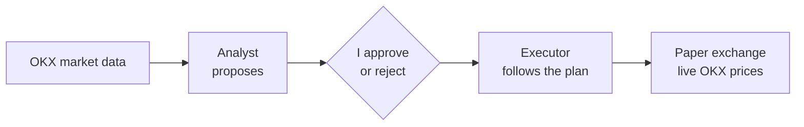

# TradeBunny

[](https://github.com/lpesseygirod/tradebunny/actions/workflows/ci.yml)

TradeBunny is a crypto grid-trading system. A grid puts buy orders below the price and sell orders above it, so it makes small profits when the price goes up and down without really going anywhere. The hard part is finding markets where that actually happens, and not losing everything when it doesn't.

So most of this project is about **measuring before trading**: it rejects almost every market, and it says exactly why.

The measuring gave a clear answer: **the strategy has no real edge, so I retired it.** Before running the final test I wrote down the rule that would decide it, and when the numbers came in I followed the rule ([the result](#the-result-no-edge-so-i-retired-it)).


> Status: **retired on 14 September 2026**, by a pass/fail rule I wrote before seeing the results. Everything is built and kept as the record: the analyst, backtester, executor, risk rules and app, with 1,428 tests. Paper trading works end to end (a simulated exchange that fills orders at live OKX prices), but the analyst correctly proposes nothing. It has never traded real money, and the client that would send real orders to OKX was never built.

**Try it offline** (no API key, no exchange, real OKX candles saved in `examples/`):

```bash
pip install -r requirements.txt
python scripts/demo.py           # runs the analyst, then opens the app
```

---

## How it works



It has two parts that are kept separate:

- **The analyst** ([`analyst.py`](src/grid/analyst.py), [`rubric.py`](src/grid/rubric.py)) looks at market data and proposes grids. It never trades.
- **The executor** ([`executor.py`](src/grid/executor.py)) follows a plan I've approved, and nothing else. It places its orders on a paper exchange that reads the real OKX price every minute and fills an order when the price reaches it. Each approved grid gets exactly the amount I approved.

OKX is used only for public market data (candles and prices) and, with a read-only key, my fee tier. No order is ever sent to OKX: the live order client ([`LiveExchange`](src/grid/executor.py)) is a stub that refuses every call.

There's no AI inside. At first an AI wrote a short summary of each plan, but I removed it: I'd rather decide by looking at the numbers than at a nice paragraph.

## Risk rules built into the code

- Spot only, no margin or futures ([`plan.validate()`](src/grid/plan.py) re-checks this on every executor pass)
- Limit orders only. If it can't read my real fees, it assumes the expensive ones
- A minimum gap between levels, so fees can't eat the profit
- Every plan has a stop loss
- Position size assumes the worst case. I found that my first sizing made a "2% risk" really 4.25%, and fixed it ([`sizing.py`](src/grid/sizing.py))
- It only picks markets that move a lot but don't trend (Hurst exponent, ADX, efficiency ratio and an ADF test, in [`metrics.py`](src/grid/metrics.py))
- If something can't be read, everything stops: three kill switches that fail closed ([`control.py`](src/grid/control.py))
- Caps on how many grids run at once and how much each one may commit. The executor re-checks them on every pass and holds back any grid over a cap (`admit` in [`executor.py`](src/grid/executor.py))
- Paper only. The live order client was never built, and arming it would also need an extra confirmation phrase

## Testing a strategy honestly

A grid that looks great on the data it was fitted on often stops working right after. So every candidate is tested **walk-forward**: the grid is fitted on the first part of the data and judged only on the part it has never seen ([`backtest.py`](src/grid/backtest.py)).

Here it is on real ETH data. Fitted on 900 hours, the grid made +4.98%. On the next 600 hours it made zero trades, because the price had left its range. So it's rejected:


<details>
<summary>On a shorter window the same check passes (+0.53% fitted, +0.76% on unseen data)</summary>


</details>

I backtest every candidate, not only the ones that look good, on 29 crypto pairs with OKX hourly data ([`docs/backtest_results.md`](docs/backtest_results.md)). Each result shows how much data it's based on, because some pairs have eight years of history and others only a few months.

## The result: no edge, so I retired it

The plain grid lost money on unseen data: **−1.41%** on average across the 29 pairs, positive on only 8 of them. So I gave myself three more ideas to try, and wrote the rule for judging them in [`docs/THEORY.md`](docs/THEORY.md) **before** running anything, so I couldn't move the goalposts afterwards.

| version | average return | pairs positive |
|---|---:|---:|
| Plain grid | −1.41% | 8/29 |
| A. One order, then re-check the market | −0.19% | 9/29 |
| B. Exit when a trend starts | −0.19% | 9/29 |
| C. Bigger orders near the top of the grid | **+1.82%** | 15/29 |

A and B only look better because they hardly trade. C looked like a winner, but when I split its profit apart, it **earned less from actual trades** than the plain grid (+17.29 vs +25.14 per 1,000 invested). Its whole advantage came from ending up holding less coin. Its confidence interval also crossed zero, and removing its two best pairs left almost nothing.

The rule asked for one more test on a second, separate time window. C again made less from trading than the plain grid, in both windows. That meant the rule's answer was "retire", so I stopped. Holding less coin is something I can choose directly. It doesn't need a grid.

The full numbers, including a mistake I made in describing one of the windows, are in [`docs/backtest_results.md`](docs/backtest_results.md).

## The app

A simple web page that works on my phone. Paper and real money are shown in clearly different sections. Each grid shows every trade like a bank statement, and compares the result with just buying and holding.

| Paper and live kept apart | Why each market was rejected |
|---|---|
|  |  |

## Run it

Python 3.12 or newer (tested on 3.13 and 3.14).

```bash
pip install -r requirements.txt
python -m pytest                                    # 1,428 tests, offline
python scripts/demo.py                              # offline demo: scan + app
PYTHONPATH=src python -m grid.cli backtest ETH-USDT --candles examples/candles/ETH-USDT_1H.json
```

With network access, the real commands are in the [`Makefile`](Makefile): `make scan`, `make web`, `make run` (the executor, trading on paper at live prices), `make check` (tests + a live OKX connectivity check). OKX public market data needs no key. Copy `.env.example` to `.env` to add a **read-only** OKX key (only used to read my fee tier) and the app token.

## Project layout

```
src/grid/         the trading system: analyst, backtest, executor, risk rules, app
src/ledger/       an earlier experiment: a news-prediction journal (docs/LEDGER.md)
tests/            1,428 offline tests
examples/candles/ real OKX hourly candles for the offline demo
docs/             design notes (DESIGN.md), the maths behind sizing (THEORY.md), results
```

## How I built it

I designed the strategy, the risk rules and the testing approach, and built it with Claude Code as my pair programmer, one module at a time with tests for each. The detailed design notes, including the variants I tried and the retirement, are in [`docs/DESIGN.md`](docs/DESIGN.md).

## Built with

Python, OKX market data API, NumPy, statsmodels, Flask, SQLite, pytest

[Lea Pessey Girod](https://github.com/lpesseygirod) · MIT licensed
