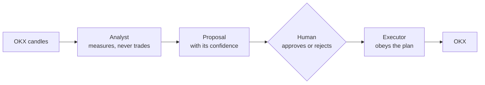

# TradeBunny: Grid Pilot

**Work in progress.** Running on paper while I test it; no real money.

**A spot grid-trading system for crypto, built to measure before it trades.** It finds markets that move a lot but go nowhere, proposes a grid of buy and sell orders, and only runs a plan a human has approved. It trades on paper by default.

> The source code is private because it connects to an exchange account. This page describes the design and the rules it enforces.

## Two halves that never mix

- **The analyst** measures which instruments oscillate without trending, and proposes grids. It never places an order.
- **The executor** applies an approved plan: buy at each level down, sell at each level up, stop if the range breaks. It has no judgement and no discretion.
- **No AI at runtime.** Every number comes from tested metrics. An earlier version had a language model write the approval note; it was removed, because fluent prose next to a trading decision invites you to read the prose instead of the numbers.

## Rules the system won't let you break

1. **Spot only:** no margin, no futures. Checked on every executor pass, not just at approval.
2. **Limit orders only,** with fee rates read from the account. If they can't be read, it assumes the *pessimistic* fee tier, never the optimistic one.
3. **Minimum spacing between levels,** so fees can't eat the profit. A plan that fails this can't run, even if approved.
4. **Every plan has a stop,** placed at `lower − max(3 × ATR, 0.20 × range)`.
5. **Position size assumes the worst case,** a stop-out at the average entry price. Sizing off the range bottom understated the loss by about half: a "2% risk" was really 4.25%.
6. **"Volatile" is not enough:** the market must move a lot *and* go nowhere (Hurst < 0.45, ADX < 25, efficiency ratio < 0.30).
7. **Fail closed:** an unreadable control file halts everything. Three kill switches.
8. **Paper by default.** Live trading needs an explicit confirmation, and the server refuses a live approval on its own, whatever the button says.

## Honest backtests

The backtest survey scores **every** candidate, not just the survivors, across 29 pairs of OKX 1-hour candles, and prints each pair's data window, because a pair listed eight years ago and one listed eight months ago can't be compared directly. Candles older than an hour can't produce a proposal.

## The interface

A single-file, mobile-first web page with PAPER and LIVE shown in visually distinct sections, so real money can't be mistaken for fake. Each grid has a bank-statement view of every fill, and always shows **buy-and-hold over the same period**: a grid that made 2% while the asset rose 40% did not work.

## Status

Analyst, backtester, executor, risk controls and web interface built; **1,270 automated tests.** Running on paper.

## Built with

Python · OKX API · pandas · SQLite · pytest
