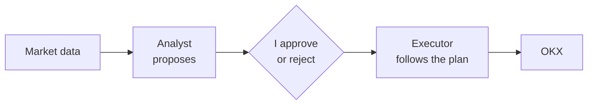

# TradeBunny

**Work in progress:** it runs on paper while I test it, with no real money.

TradeBunny is a crypto grid-trading system. A grid puts buy orders below the price and sell orders above it, so it makes small profits when the price goes up and down without really going anywhere. The hard part is finding markets where that actually happens, and not losing everything when it doesn't.

The code is private because it connects to an exchange account.

## How it works

It has two parts that are kept separate:

- **The analyst** looks at market data and proposes grids. It never trades.
- **The executor** follows a plan I've approved, and nothing else.

There's no AI inside. At first an AI wrote a short summary of each plan, but I removed it: I'd rather decide by looking at the numbers than at a nice paragraph.

## Risk rules built into the code

- Spot only, no margin or futures
- Limit orders only. If it can't read my real fees, it assumes the expensive ones
- A minimum gap between levels, so fees can't eat the profit
- Every plan has a stop loss
- Position size assumes the worst case. I found that my first sizing made a "2% risk" really 4.25%, and fixed it
- It only picks markets that move a lot but don't trend (using Hurst, ADX and efficiency ratio)
- If something can't be read, everything stops
- Paper by default. Live trading needs an extra confirmation

## Testing

I backtest every candidate, not only the ones that look good, on 29 crypto pairs with OKX hourly data. Each result shows how much data it's based on, because some pairs have eight years of history and others only a few months.

## The app

A simple web page that works on my phone. Paper and real money are shown in clearly different sections. Each grid shows every trade like a bank statement, and compares the result with just buying and holding.

## Status

The analyst, backtester, executor, risk rules and web page are built, with 1,270 tests. It runs on paper.

## Built with

Python, OKX API, pandas, SQLite, pytest
